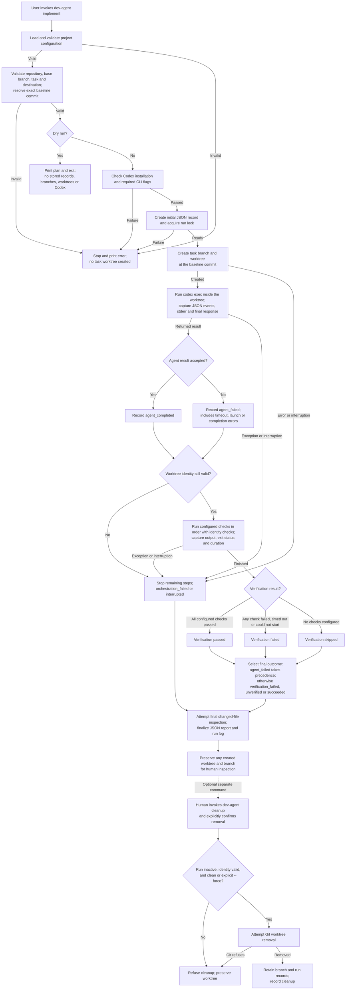

# dev-agent

A local development orchestration CLI that sends an approved Markdown task to
Codex CLI in a separate Git worktree, runs predefined checks and saves a JSON
report. Every run keeps its worktree for human review, including failed runs.
The orchestrator never commits, pushes, merges or deploys.

This MVP targets Ubuntu/Linux and Python **3.14+**, uses `uv`, and has no runtime
dependencies outside the Python standard library. It runs one agent per invocation.

## Execution workflow

`dev-agent implement` validates inputs before creating run state. During execution,
it updates the JSON record between phases and captures subprocess output separately.



Agent failure does not skip verification. If the agent completes, failed checks
produce `verification_failed`, no configured checks produce `unverified`, and all
configured checks passing produce `succeeded`. Final inspection errors can replace
`succeeded` or `unverified` with `orchestration_failed`. Storage failures or abrupt
process termination can leave incomplete records; see Reports and architecture.

The orchestrator leaves the source checkout unchanged and runs Codex with restricted
workspace writes and no approval escalation. Worktrees share Git metadata, and the
Codex sandbox does not fully isolate local reads. Human inspection remains separate
from execution; cleanup requires confirmation and refuses uncommitted, untracked or
ignored files unless `--force` explicitly authorizes their loss. There are no
automatic retries, repair loops, merges, pushes or deployments.

## Install on Ubuntu/Linux

Install Git, Python 3.14 and [uv](https://docs.astral.sh/uv/getting-started/installation/).
From this repository:

```bash
uv python install 3.14
uv sync --locked
uv run dev-agent --help
```

`uv.lock` pins the development dependencies. For a CLI available outside
this checkout, install it with `uv tool install --python 3.14 /path/to/dev-agent`.
Otherwise prefix the examples below with `uv run` from this checkout.

Install [Codex CLI](https://developers.openai.com/codex/cli/) separately and run
`codex login` yourself. dev-agent reuses local Codex authentication; it does not
read, copy or store credentials and has no OpenAI API integration. The installed
CLI must support `exec`, `--json`, `--output-last-message`, `--sandbox`,
`--ephemeral`, `--ignore-user-config` and `--ignore-rules`. Preflight checks the
interface before creating worktrees. The adapter was developed against 0.169.0;
older versions without these safety controls are rejected.

## Configure a project

```bash
mkdir -p ~/.config/dev-agent
cp examples/config.toml ~/.config/dev-agent/config.toml
```

Edit the copy: set `repository` to an existing local Git working tree root with a
committed local `base_branch`; set `worktree_root` and `runs_root` outside **all**
project repositories and outside each other. Synthetic example paths are not
created automatically. Remove unused example entries or configure them too.
The source checkout may be dirty: a run starts from the exact base-branch commit,
excluding source uncommitted changes. It does not fetch or update the base branch.

Verification is an ordered array of `{name, argv, timeout_seconds}` tables. Each
`argv` is a literal argument array, executed without shell expansion in the
worktree. Use separate entries for separate checks. No `&&`, pipes, variable
interpolation or task-supplied commands are interpreted by the orchestrator.
Operator configuration is trusted executable policy: explicitly configuring a
shell/interpreter or repository test script can execute arbitrary code.
Check names must be unique; timeout values are positive integer seconds.

The only optional agent settings are `model`, `reasoning_effort` and
`timeout_seconds`. Model availability and accepted reasoning effort depend on
your Codex account/model; unsupported combinations fail visibly. No arbitrary
Codex flags, network override or approval bypass settings are accepted.

Paths expand `~`; relative paths resolve against the config file. Unknown settings,
unsafe identifiers, overlapping paths and malformed commands fail validation.
The default config follows `XDG_CONFIG_HOME`; run records default under
`XDG_STATE_HOME` (normally `~/.local/state/dev-agent/runs`). Use global
`--config /path/to/config.toml` **before** the subcommand to select another config.
Do not put private configuration or credentials into this repository.

## Commands

```bash
dev-agent projects list
dev-agent implement TASK-123 --project example --prompt-file examples/tasks/TASK-123.md --dry-run
dev-agent implement TASK-123 --project example --prompt-file examples/tasks/TASK-123.md
dev-agent runs list
dev-agent runs show RUN-ID
dev-agent inspect RUN-ID
dev-agent cleanup RUN-ID
dev-agent cleanup RUN-ID --yes
```

Dry-run validates configuration, the Git repository, base branch, prompt and
destination, then prints the planned Git operation and run metadata. It does not
create directories, run records, branches or worktrees, or invoke Codex (including
preflight). Its run ID is a preview, not a reserved ID. Real executions generate
UTC timestamp/project/task/random-suffix IDs and `dev-agent/RUN-ID` branches.
Existing branches, files, symlinks and registered worktrees are never overwritten.

`runs show` prints the stored report; `inspect` performs current read-only Git
inspection and shows changed paths, diff statistics and log location. Filenames
and report strings are escaped for safe terminal display. Inspect does not invoke
an agent, execute repository scripts or open an editor.

Cleanup requires typing the exact run ID at a terminal or passing `--yes`.
It checks repository/worktree identity and refuses dirty worktrees, including
untracked **and ignored** files. It refuses active runs and changed registrations.
To explicitly discard all uncommitted work, use:

```bash
dev-agent cleanup RUN-ID --force --yes
```

**Force permanently deletes all worktree files, including uncommitted, untracked
and ignored files.** Review/back up your work first. The branch and run records
are retained, so committed changes remain recoverable. Cleanup never deletes a
branch, prunes other worktrees or removes the source checkout. Keep the original
project name/storage configuration while inspecting or cleaning old runs; moved,
replaced or manually changed worktrees require manual review.

Exit codes: `0` successful checks (or a successful read/dry-run/cleanup command),
`2` validation/CLI/preflight error, `3` agent failure, `4` failed or absent
verification, `5` orchestration failure, `130` interrupted run. All configured
checks run sequentially after the agent exits, even when the agent fails, unless
execution is interrupted or the worktree cannot be safely identified. No repair
loop runs. Checks may still fail because dependencies, executables or services
are unavailable; their actual exit/error/timeout is recorded.

## Reports and architecture

Each private run directory contains:

- `record.json`: atomic, versioned report with identity, baseline SHA, branch,
  paths, timestamps, prompt hash, agent configuration/version/process result,
  check argv/results/durations, changed filenames, outcome and cleanup history.
- `run.log`: human-readable phase/check/outcome messages.
- `agent-events.jsonl`, `agent.stderr.log`, `final-response.md`: Codex JSONL
  events, stderr and final response.
- `check-NAME.stdout.log`, `check-NAME.stderr.log`: raw verification output.

The task itself is passed on stdin, not the process command line or an additional
stored prompt copy. Reports distinguish `implementation_status` (agent completion)
from `verification_status`. `succeeded` requires a completed Codex turn, a nonempty
final response, a zero process exit and every configured check passing. An agent
response is not proof that acceptance criteria are met; human review is required.
No configured checks produces `unverified`, never success. A running phase left
after SIGKILL/power loss is incomplete evidence. Normal Ctrl-C/SIGTERM terminates
the process group and attempts to persist an interrupted report. Disk/storage
failures can prevent final persistence; inspect the last durable record and logs.

Modules under `src/dev_agent`:

- `config`: strict TOML parsing and project/storage validation.
- `git`: allowlisted local operations, exact baselines, creation and inspection.
- `agent`: narrow `AgentRunner` protocol and the single Codex implementation.
- `process`: bounded subprocess execution and group termination on timeout.
- `records`: private storage, atomic JSON writes and per-run Linux advisory locks.
- `orchestrator`: plan, execute, verify, report and explicit cleanup.
- `cli`: argparse commands and meaningful exit codes.

There are no remote-service clients, task selectors, databases, frameworks,
automatic commits/PRs, schedulers or concurrent-agent workflows.

## Security and limitations

Tasks and repository instructions are untrusted context. The orchestrator never
parses their contents as commands or policy. It reads the baseline's regular,
bounded root `AGENTS.md` as coding guidance; the agent can consult relevant nested
instructions. Prompts cannot change the hard-coded Git operations, configured
checks, output paths or sandbox options. Prompt injection can still affect the
agent's reasoning: instructions alone do not enforce behavior.

Codex is launched with explicit `workspace-write`, `approval_policy="never"`,
shell network disabled, web search disabled and no additional writable roots.
Default temporary writable roots are excluded. User config/rules are ignored,
the task project is marked untrusted to skip project config, automatic instruction
loading is disabled, and optional hooks/apps/plugins/memory/multi-agent features
are disabled. Local authentication is reused. System/managed Codex configuration
and the installed binary remain trusted; dev-agent is not a sandbox implementation.
See [Codex sandbox and approval documentation](https://developers.openai.com/codex/security)
and the [configuration reference](https://developers.openai.com/codex/config-reference).

**Workspace sandboxing restricts writes, not all local reads.** It does not provide
confidentiality isolation from the user's home, shared Git metadata, credentials
readable to the host process or symlink targets. The agent's model connection still
uses the network. dev-agent does not add unrelated directories, forward credential
environment variables or expand repository permissions. Use a dedicated OS user,
container or VM with only required files/auth for hostile content or sensitive hosts.
Dependencies or builds needing wider writes/network may fail; this MVP does not
automatically grant more permissions. It also does not sandbox configured checks.

Git worktrees share object storage, configuration and refs. This protects the source
checkout from the orchestrator's normal operations, but is not a security boundary
against a malicious agent, test, tool or local process. Hooks and fsmonitor are
disabled for orchestrator Git commands; system/global Git config is ignored, and
repositories with local checkout filters (for example Git LFS) are rejected to
avoid executing filters during checkout. Submodule setup is not performed.
Verification uses a reduced environment too: PATH/HOME/user/locale/terminal and
CODEX_HOME only, without inherited Git overrides or API/cloud keys. Commands and
code they execute remain trusted by the operator and may read files or use network.

Run directories are owner-only; records are mode 0600. Raw event streams, final
responses, stderr and test output **can contain confidential content or secrets
emitted by tools**. Automatic redaction cannot reliably preserve both arbitrary
structured events and secrecy, so no comprehensive redaction is claimed. Do not
put secrets into prompts/check arguments; protect the state directory and review
logs before sharing. No environment dump, auth data or prompt copy is recorded.
There is no log rotation/quota; monitor storage for long-running tasks.

Cleanup validates current config, repository identity, branch and exact registered
path and uses Git's worktree removal, never a general recursive deletion. Advisory
locks prevent this CLI from cleaning an active run; they do not prevent a human or
other tool modifying files between inspection and removal. Do not modify worktrees
concurrently with cleanup. SIGKILL/power loss cannot guarantee a final report or
termination of orphan descendants; inspect running processes before manual recovery.

## Development

```bash
uv sync
uv run pytest
uv run ruff check .
uv run ruff format --check .
```

Tests use temporary repositories and fake/mock Codex processes. They require Git,
but no real authentication, network, Jira or GitHub account. No real paid Codex
implementation run is part of the test suite. The recommended next stage is a
manual end-to-end qualification against supported Codex releases in a disposable
container, before adding another provider or unattended automation.

## Licence recommendation

**Apache-2.0** is recommended for this independent open-source project: permissive
reuse with an explicit contributor patent grant. No licence file has been added;
the maintainer should approve the choice and add the standard text/copyright
details before publishing. Until then, this repository has no open-source licence
grant. Nothing is pushed or published by dev-agent.
