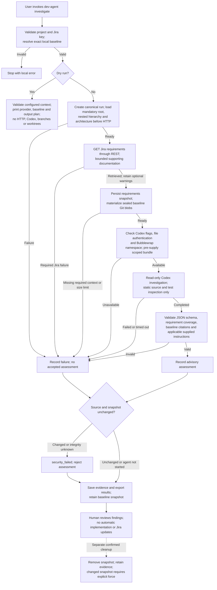

# Developer architecture

Dev Agent coordinates local work on a managed Git repository. It can assess a
Jira issue against committed source, implement a reviewed brief, check a retained
candidate, or publish an approved manifest as a draft PR. Its authoritative
evidence stays on the operator's machine. Start with the [Quick Start](quickstart.md)
for commands or [setup](setup.md) for configuration and operational details.

## Packages and dependencies

| Owner | Responsibility |
| --- | --- |
| [`cli.py`](../src/dev_agent/cli.py) and [`run_admin.py`](../src/dev_agent/run_admin.py) | Argparse entry point, exit codes, cross-run inspection and explicitly confirmed cleanup. The console script and `python -m dev_agent` use the same dispatcher. |
| [`config.py`](../src/dev_agent/config.py) | Strict external TOML, typed project selection, trusted command vectors and storage separation. |
| [`providers/`](../src/dev_agent/providers/) | Runner contract, Codex factories and safe CLI invocation. The read-only adapter adds a Bubblewrap namespace for investigation and review. |
| [`integrations/`](../src/dev_agent/integrations/) | Bounded Atlassian REST reads and trusted GitHub CLI calls. Credentials are scoped to their integration. |
| [`repository/`](../src/dev_agent/repository/) | Local Git, exact baseline and worktree identity, sealed snapshots, instruction resolution and scope audits. |
| [`investigation/`](../src/dev_agent/investigation/) | Standalone static assessment, structured result validation and the packaged v1 schema. |
| [`delivery/`](../src/dev_agent/delivery/) | Implementation, ticket checkpoints, independent review, publication eligibility and CI observation. |
| [`verification/`](../src/dev_agent/verification/) | Preparation, prerequisite checks, verification profiles and evidence matched to source and configuration. |
| [`records.py`](../src/dev_agent/records.py), [`process.py`](../src/dev_agent/process.py) and [`errors.py`](../src/dev_agent/errors.py) | Canonical JSON, per-run advisory locks, bounded subprocess handling and shared exceptions. |
| [`reporting/`](../src/dev_agent/reporting/) | Private projections, log and evidence copies, and Markdown reports. |

The CLI calls workflows. Workflows use providers, integrations, repository
operations and verification. Delivery reuses investigation's assessment validator.
Reporting consumes canonical records without importing workflows. Git mechanics and
canonical storage have no dependency on publication authorisation.

## Delivery lifecycle

`deliver` accepts a project and Jira key. The following describes the order in
the controller and where current production execution stops.

1. **CLI and configuration.** Argparse identifies operator intent. `load_config`
   loads the external TOML, rejects unknown settings and records a digest of the
   exact bytes. Delivery resolves the local baseline and mandatory instructions,
   then requires nonempty targeted and full profiles and GitHub destination
   configuration. Dry-run returns here without reserving storage.
2. **Jira MCP intake.** Live delivery reserves a canonical record and reaches
   `mcp_intake`. This gate currently records `mcp_unavailable`. Bounded host
   connectivity and synthetic tool filtering were demonstrated, but the
   isolated runtime could not authenticate to Atlassian. No requirements reach
   the delivery workflow in production. The separate `investigate` command uses
   GET-only REST and is not a delivery fallback. See [MCP qualification](mcp-qualification.md).
3. **Investigation and planning.** With synthetic intake in tests, the controller
   validates snapshot identity, original requirement units, source hashes, cited
   baseline evidence and suitability. It rejects an assessment that requires a
   human decision. It generates a Markdown brief with requirements, finding
   citations and constraints, and persists it with the plan and instruction
   evidence in the delivery record directory.
4. **Isolated implementation.** The controller reserves an implementation run ID
   and creates its task branch and worktree at the exact baseline. Trusted
   preparation and checks use configured argument arrays and worktree-relative
   directories. The runner selects the configured Codex model and reasoning
   effort, or uses the CLI default if omitted. It sends the prompt on stdin and
   retains events, stderr and the final response.
5. **Instructions and verification.** The committed root `AGENTS.md` is mandatory.
   The resolver discovers the nested hierarchy in Git objects, loads a bounded
   bundle, records hashes and validates applicable ancestor chains for changed or
   cited paths. A scoped audit includes ignored files and rejects changes to
   mandatory instruction authority. This enforces context supply and path scope.
   Individual tool calls and semantic obedience are outside the evidence.
   Verification separately records prerequisite and command results, config digest
   and before/after fingerprints. Delivery requires both profiles to pass for the
   same source before review and publication.
6. **Independent review.** A separate ephemeral Codex invocation uses a sealed
   candidate snapshot, a read-only namespace, the requirement evidence and the
   instruction bundle. It excludes the implementation transcript. The controller
   validates the review schema, candidate fingerprint, criterion coverage,
   citations and verdict, then rechecks integrity. Review is advisory and static.
7. **Publication.** The preview validates worktree identity, source-bound evidence,
   instruction compliance, applicable review evidence, staging scope and remote
   destination. With explicit confirmation, it stages the approved manifest,
   checks blob hashes and modes, commits in the retained task worktree, pushes
   that branch without force, and creates or reuses the draft PR. Existing
   workflows might run as a consequence of the push or PR. Merge is manual.
8. **CI monitoring and report.** CI records check runs and statuses for the
   published SHA after comparing it with the PR head. Watch mode observes eligible
   pending states within a deadline. Missing, skipped and unavailable checks
   cannot count as passing. The CLI emits phase progress and a final JSON summary.

## Checkpoints and safety

Canonical records live under `runs_root/RUN-ID/`. A delivery's parent record
references its implementation run. The latter owns the source-bound verification
and review history, publication evidence and CI observations. Results under
`results_root/TASK-ID/RUN-ID/` are projections with links to evidence.

Resumption checks project, ticket, configuration digest, baseline, artifact
hashes and child linkage. It reuses the linked implementation run. An uncertain
implementation state stops for inspection.
Publication persists its phase and reconciles existing commits, remote heads
and PRs before recovering. Failed prerequisites, source changes and missing
evidence keep the corresponding gates closed. Per-run locks and atomic record
replacement preserve useful checkpoints without implying transactional rollback
of Git or GitHub. See [recovery](quickstart.md#recovery-and-resumption).

## Test layout

The root covers configuration, record storage and process handling.
`tests/providers` and `tests/integrations` contain direct adapter contracts.
`tests/repository`, `tests/investigation`, `tests/delivery`, `tests/verification`
and `tests/reporting` group subsystem checks by the invariant they protect.
`tests/integration` covers cross-package CLI, cleanup and delivery checkpoints.
Those workflows use temporary Git repositories and fake runners and remotes.

Shared fixture factories live in [`tests/support`](../tests/support/). The root
[`conftest.py`](../tests/conftest.py) shares the temporary repository, configuration,
prompt and fake Codex fixtures. Test modules share these fixtures and helpers.
The tests root has an `__init__.py` so its `tests.support`
imports resolve with pytest's default import mode. The subsystem directories
need no package initialisers.

```bash
uv run pytest
uv run pytest tests/repository tests/verification
uv run pytest tests/integration
```

## Execution workflow

Trusted external configuration controls setup and checks. Task/repository text
supplies engineering context, never orchestration policy. Both workflows require a
valid baseline root `AGENTS.md` and automatically discover the nested hierarchy.
Scoped bodies and mandatory architecture documents are pre-supplied as a bounded
bundle; sibling instructions apply only within their own directory subtrees.

```mermaid
flowchart TD
    Delivery["User invokes dev-agent deliver"] --> DeliveryGate["Validate project, baseline and mandatory hierarchy;<br/>require targeted/full profiles and GitHub configuration"]
    DeliveryGate --> MCPGate["Require qualified Codex Atlassian MCP intake"]
    MCPGate --> DeliveryBlocked["Currently unavailable: record blocker and stop;<br/>no REST fallback, implementation or publication"]
    Start["User invokes dev-agent implement"] --> Inputs["Load and validate configuration;<br/>validate repository, base branch, task and destination"]
    Inputs -->|Invalid| Reject["Stop with an error; no task worktree created"]
    Inputs -->|Valid| Instructions["Resolve mandatory root and nested instructions;<br/>load required architecture and approve modification scopes"]
    Instructions -->|Unavailable, invalid or oversized| Reject
    Instructions -->|Ready| Dry{"Dry run?"}
    Dry -->|Yes| Plan["Print plan and exit;<br/>no setup, worktree, stored results or Codex"]
    Dry -->|No| Preflight["Check Codex CLI availability and supported flags"]
    Preflight -->|Failure| Reject
    Preflight -->|Passed| Create["Create canonical record, reserve results directory;<br/>create task branch and worktree at exact baseline"]
    Create -->|Ready| Prepare["Run configured preparation commands in order;<br/>capture logs, timing and status"]
    Create -->|Error or interruption| Abort["Stop remaining steps;<br/>orchestration_failed or interrupted"]
    Prepare -->|Required command failed| EnvFailed["environment_failed; do not execute Codex"]
    Prepare -->|Required commands passed; retain optional warnings| Prerequisites{"Declared prerequisites available?"}
    Prepare -->|Exception or interruption| Abort
    Prerequisites -->|No| EnvFailed
    Prerequisites -->|Yes| InstructionGate["Audit worktree including ignored files;<br/>check baseline context and supply complete scoped bundle"]
    InstructionGate -->|Failure| InstructionFailed["instructions_failed; no accepted implementation"]
    InstructionGate -->|Ready| Codex["Run restricted codex exec in the worktree;<br/>capture events, stderr and final response"]
    Codex -->|Accepted completion| AgentPassed["Record agent_completed"]
    Codex -->|Unsuccessful result or timeout| AgentFailed["Record agent_failed"]
    Codex -->|Exception or interruption| Abort
    AgentPassed --> ChangedGate["Audit all agent changes against approved scope<br/>and supplied instruction chains"]
    AgentFailed --> ChangedGate
    ChangedGate -->|Violation or incomplete audit| InstructionFailed
    ChangedGate -->|Validated| Verify["Validate worktree identity and prerequisites;<br/>fingerprint source before and after; run selected profile in order"]
    Verify -->|Missing prerequisites| Missing["Record missing verification prerequisites;<br/>agent_failed or environment_failed"]
    Verify -->|Exception or interruption| Abort
    Verify -->|Finished| Outcome["Record passed, verification_failed or unverified;<br/>agent failure takes precedence;<br/>optional setup failures remain warnings"]
    Outcome --> FinalAudit["Validate final file scopes;<br/>retain separate evidence for verification writes"]
    FinalAudit -->|Violation| InstructionFailed
    FinalAudit -->|Validated| Final["Inspect changes; save canonical JSON;<br/>export summary, report and logs"]
    InstructionFailed --> Final
    Missing --> Final
    EnvFailed --> Final
    Abort --> Final
    Final --> Keep["Preserve any created worktree and branch;<br/>human inspection, no automatic approval"]
    Keep -.->|Explicit verify command| Reverify["Append a verification attempt; optional --prepare;<br/>fingerprint current source; never rerun Codex"]
    Reverify --> Keep
    Keep -.->|Separate publish --draft --dry-run| PubPlan["Validate worktree, instruction scopes, source identity,<br/>GitHub destination and targeted/full verification;<br/>delivery runs also require independent review;<br/>preview explicit file manifest; no writes"]
    PubPlan --> Approval{"Explicit --confirm and all gates passed?<br/>Incomplete full checks need a separate acknowledgement"}
    Approval -->|No| Keep
    Approval -->|Yes| Publish["Commit only approved files; push task branch without force;<br/>create or recover draft PR; preserve partial failure evidence"]
    Publish --> CI["Observe checks for the exact published commit;<br/>record passed, failed, pending, absent or unavailable CI"]
    CI --> Review["Human reviews draft and CI;<br/>merging is always manual"]
    Keep -.->|Separate cleanup command and confirmation| Guard{"Cleanup safety checks pass?<br/>Dirty files require explicit --force"}
    Guard -->|No or Git refuses removal| Refuse["Preserve worktree"]
    Guard -->|Yes and Git removes it| Removed["Retain branch, canonical records and exported results"]
```



Verification can run after agent failure; it remains a separate result. Missing
prerequisites, failed commands, timeouts and skipped checks are not clean passes.
Worktrees and Codex workspace restrictions do not provide complete local-read
isolation; trusted preparation/check commands execute outside the agent sandbox.
Human review and cleanup remain explicit.

Investigation is a separate, read-only command. After mandatory baseline context
validation, the Python orchestrator retrieves Jira/Confluence before Codex; Codex receives snapshots, never Atlassian credentials.



The namespace mounts the baseline read-only, hides the source checkout and parent
process environment, and retains Codex's restricted approvals/network policy.
Investigation runs no preparation or verification commands. Complete instruction
availability and cited/changed scope validation are enforced; there is no per-tool
interception or proof of semantic obedience. Schema-valid static
findings still require human review. See the [investigation setup and limitations](setup.md#jira-investigation).

Codex MCP replacement is currently **unqualified**. A bounded native catalogue
probe reached Atlassian when network access was enabled. Isolated authentication
and access to its authenticated read-tool catalogue remain unverified. Standalone
investigation uses the REST provider. See
[qualification findings and migration gates](mcp-qualification.md).

